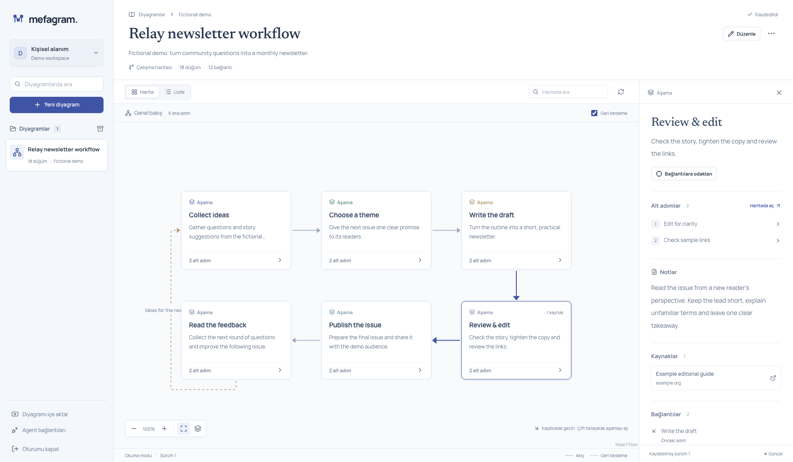
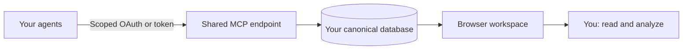

# Mefagram — From agent conversations to living diagrams

A private diagram workspace where AI agents maintain the map and people read, explore and analyze it.

Free, MIT-licensed and self-hosted. Interactive React Flow canvas, hierarchical drill-down, notes and sources, search, revision history, JSON import/export, and authenticated HTTP MCP. No model API key, paid canvas license or Mefagram subscription is required. The current interface is in Turkish; the data and integration contracts are language-independent.



The screenshot uses a completely fictional newsletter workflow and a demo account. [Download the example JSON](docs/examples/newsletter.json) to explore it in your own workspace.

## One workspace, all your agents



Each installation has its own owner, database and credentials. Connect all of **your** agents to that installation's `/api/mcp` endpoint: updates appear in the same browser workspace. Other developers can clone the project and run independent installations. Cloning code onto every agent computer does not synchronize diagram data.

## Start locally

Requires Node.js 24+ and a desktop browser. No Docker or separate database installation is needed.

```sh
git clone https://github.com/berkinduz/mefagram.git
cd mefagram
npm ci
npm run setup -- --name "Your name" --email you@example.com
npm run build
npm start
```

Open [127.0.0.1:3000](http://127.0.0.1:3000). Your generated login password and bootstrap agent token are stored privately in `.mefagram/local-access.json`; setup prints the path without printing the secrets. New workspaces start empty. Name/email options are optional; the email is a login identifier, not an email delivery service.

Subsequent starts only need `npm start`. Use `npm run dev` for development. Stop the app before rerunning setup; one Node process owns a local PGlite directory. For an optional proposed product-studio example, run `npm run setup -- --example mefa-apps` while stopped. Repeating setup preserves existing data, credentials and edits to that example.

[Installation, updates and backup](docs/installation.md) · [Türkçe başlangıç](docs/README.tr.md)

## Read and explore

- Search and open named diagrams from the library. The workspace opens in reading mode.
- Pan, zoom and fit the canvas; expand a phase to inspect its smaller process.
- Select a node for descriptions, notes, sources and relationships. A list view supports longer text and keyboard navigation.
- Enable editing deliberately to change nodes and edges. Only server-acknowledged changes count as saved.
- Export/import portable JSON, archive a diagram, or restore an earlier revision as a new revision.
- Agent changes are checked roughly every 15 seconds in a visible reading tab; refresh opens the latest saved version immediately.

Semantic nodes, edges and hierarchy are stored independently of their visual layout. Keep large maps readable by separating phases and placing detailed evidence in node notes and sources.

## Connect agents

With the local server running:

```sh
npm run agent -- list
npm run agent -- get <diagram-id>
npm run agent -- tools
npm run agent -- call update_diagram /absolute/path/to/arguments.json
```

This is a real MCP client, not a direct database editor. It reads the local private access file. A remote agent can use `MEFAGRAM_URL` and `MEFAGRAM_AGENT_TOKEN`, or an OAuth-capable client can authorize against `<your-origin>/api/mcp`.

Seven tools cover list, get, create, patch, history, restore and export. Updates require an expected revision and mutation ID. Concurrent stale writes fail explicitly; identical retries recover the committed result. Agents should read, patch stable IDs, and reconcile conflicts.

[Agent integration and tool examples](docs/agent-integration.md)

## Local or hosted

Local data persists on disk in `.mefagram/db` using PGlite. Viewing and editing work offline after dependencies are installed; remote AI services still need their own network access. A cloud agent cannot reach your Mac's loopback address.

For agents on different computers, use **one reachable private installation** with a stable HTTPS origin and durable storage. A persistent single-process host can use PGlite; serverless/multiple app instances require external Postgres through `DATABASE_URL`. Vercel and Netlify reject database initialization without it. Other stateless hosts should set `MEFAGRAM_REQUIRE_DATABASE_URL=true`.

The software has no license or AI API fee. Hosted providers have their own prices, free quotas and eligibility rules; unlimited free hosting is not promised. Running a copy in an agent's cloud computer is possible when its runtime and network support it, but stable external access and backups must be arranged explicitly.

[Deployment and shared endpoint setup](docs/deployment.md)

## Own and move your data

No public signup or telemetry service is configured by Mefagram. Each instance is a single-owner private workspace, not a multi-user SaaS. OAuth 2.1/PKCE and scoped, expiring personal tokens protect MCP access. Browser-issued tokens can be revoked immediately; issued OAuth access JWTs have a maximum five-minute remaining lifetime.

Back up the entire stopped local database and auth configuration for full recovery. [JSON export](docs/diagram-export.schema.json) preserves current diagram content, including hierarchy, notes, sources and position overrides; it does not transfer accounts, credentials or full history.

Current limits: 2 MB canonical content, 8 MB transfer envelope, 2,000 nodes, 6,000 edges and 12 hierarchy levels. These are validation limits, not a performance guarantee; the browser suite includes a 150-node map.

## Develop and contribute

```sh
npm run typecheck
npm run lint
npm test
npm run build
npx playwright install chromium
MEFAGRAM_TEST_PRODUCTION=1 npm run test:e2e
```

The build checks that private data and credentials are absent from traced deployment files. Browser tests use disposable fixtures, not your workspace. CI also tests native Postgres. [Verification evidence and limits](docs/verification.md) distinguishes localhost tests from actual remote-client acceptance.

Contributions are welcome: [CONTRIBUTING.md](CONTRIBUTING.md). Report vulnerabilities privately using [SECURITY.md](SECURITY.md). [MIT license](LICENSE); bundled dependencies retain their own [licenses](NOTICE.md).
