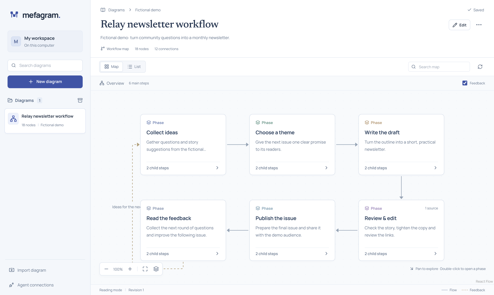
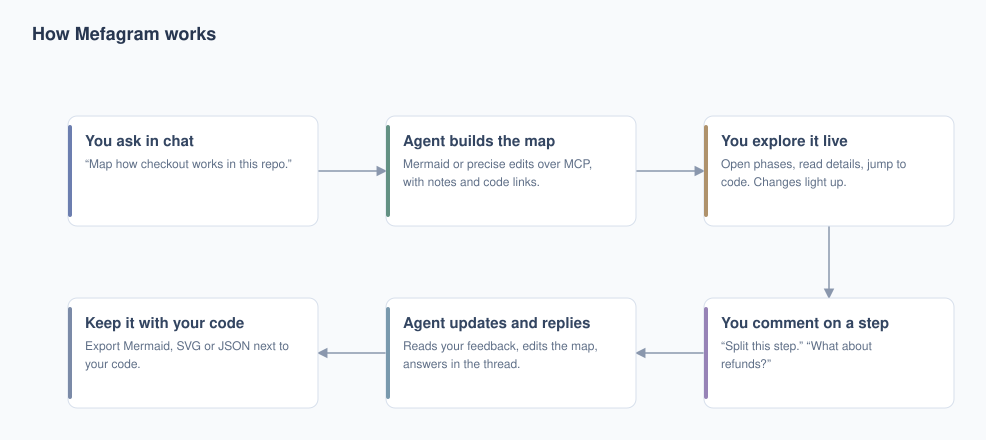

<div align="center">


# Mefagram

**Diagrams your AI agent can edit. You explore them, and talk back.**

A local MCP workspace for Claude Code, Codex and any MCP client: your agent maps workflows, plans and codebases; you read them in the browser, comment on any step, and the agent updates the map.

[](https://www.npmjs.com/package/mefagram)
[](https://www.npmjs.com/package/mefagram)
[](https://github.com/berkinduz/mefagram/actions/workflows/ci.yml)
[](https://github.com/berkinduz/mefagram/blob/main/LICENSE)
[](https://nodejs.org)

[Quick start](#quick-start) · [How it works](#how-it-works) · [Features](#features) · [Agent guide](https://github.com/berkinduz/mefagram/blob/main/docs/agent-integration.md) · [npm](https://www.npmjs.com/package/mefagram)

<br>



</div>

## Why Mefagram

Long chats produce great plans, architecture sketches and checklists, and then they scroll away. Diagram tools are built for people drawing by hand, not for agents. Mermaid in a chat is a snapshot nobody can iterate on.

Mefagram is the missing piece in between: a **persistent, structured diagram store that agents write through MCP and people read in the browser**, with a feedback loop in both directions. It runs entirely on your machine, with no account, API key or cloud service.

## Quick start

You need [Node.js 24+](https://nodejs.org).

**Claude Code**: install the plugin. It adds the MCP server and skills to map a process, map your codebase and handle your comments.

```text
/plugin marketplace add berkinduz/mefagram
/plugin install mefagram@mefagram
```

**Codex**: the CLI, the IDE extension and the ChatGPT app share this setting.

```sh
codex mcp add mefagram -- npx -y mefagram mcp
```

**Any other MCP client**: run `npx -y mefagram mcp` as a stdio server, or connect over HTTP to `http://127.0.0.1:4747/api/mcp`.

The agent starts the workspace when it needs it. Open it yourself with `npx mefagram open`, then try:

> *Map how a request flows through this repo, with links to the code.*

## How it works

<p align="center">
  
</p>

<sub>This diagram was exported by Mefagram itself (`export_diagram` with `format: "svg"`).</sub>

## Features

| Feature | What it does |
| --- | --- |
| **Ask, don't draw** | Agents create maps from Mermaid, which they already write fluently, then add descriptions, notes, sources and code links with atomic edits. |
| **Talk back** | Comment on any node or diagram. The agent reads it with `get_feedback`, changes the map and replies in the thread. It can ask you questions too. |
| **Shared context** | `get_current_view` tells the agent what you have open, so "expand this step" just works. |
| **Live** | Changes stream into the browser as they are saved, and the nodes the agent touched light up. |
| **Jump to the code** | Codebase maps link each step to its file and line, opening in VS Code, Cursor, Windsurf or Zed. |
| **Readable at any size** | Phases collapse into an overview; open one for its steps. Map or list view, search, revision history and restore. |
| **Safe for agents** | Optimistic revisions, retry-safe mutation IDs and validation mean concurrent agents never overwrite each other. |
| **Portable** | Export Mermaid for pull requests, standalone SVG for docs, or lossless JSON you can commit and re-import. |
| **Local and private** | One workspace on your machine, shared by all your agents. Only requests from this computer are accepted. |

## Tools for agents

| Tool | Purpose |
| --- | --- |
| `create_diagram_from_mermaid` | Create a map from a Mermaid flowchart (subgraphs become phases) |
| `get_diagram` · `list_diagrams` | Read a map; search maps, optionally within a project |
| `update_diagram` | Add, change or remove nodes and connections atomically |
| `get_current_view` | The diagram, phase and node the developer has open |
| `get_feedback` · `resolve_feedback` · `ask_developer` | The comment loop between developer and agent |
| `export_diagram` | JSON, Mermaid or SVG |
| `get_diagram_history` · `restore_diagram` | Revision history and restore |

Every result includes a `viewUrl` the agent can hand you. Details, examples and conventions are in the [agent guide](https://github.com/berkinduz/mefagram/blob/main/docs/agent-integration.md).

## Command line

| Command | What it does |
| --- | --- |
| `npx mefagram mcp` | MCP over stdio; starts the workspace if needed |
| `npx mefagram open [id]` | Open the workspace in your browser |
| `npx mefagram start` · `stop` · `status` | Run it yourself (`--background` to detach, `--port` to move it) |
| `npx mefagram export docs/diagrams --project my-repo` | Write a project's maps as `.mefagram.json`, `.mmd` and `.svg` |
| `npx mefagram import <file>` | Import a JSON export or a Mermaid file |

Data lives in `~/.mefagram`. Stop the workspace and copy that folder to back it up.

## Privacy and security

Mefagram has no accounts, so the loopback interface is its boundary. It listens on `127.0.0.1:4747` and refuses requests addressed to any other host (blocking DNS rebinding) or sent by another website. Don't expose the port through a tunnel or proxy. Diagram content is treated as data, never as instructions to the agent. See [SECURITY.md](https://github.com/berkinduz/mefagram/blob/main/SECURITY.md).

## Run from source

```sh
git clone https://github.com/berkinduz/mefagram.git
cd mefagram
npm ci
npm run setup -- --example newsletter
npm run build
npm start
```

Connect agents with `node /path/to/mefagram/bin/mefagram.mjs mcp`. Inside the repository, Claude Code and Codex pick up the bundled `.mcp.json` and `.codex/config.toml`. See [installation and backup](https://github.com/berkinduz/mefagram/blob/main/docs/installation.md) and [contributing](https://github.com/berkinduz/mefagram/blob/main/CONTRIBUTING.md).

## License

[MIT](https://github.com/berkinduz/mefagram/blob/main/LICENSE). Third-party notices are in [NOTICE.md](https://github.com/berkinduz/mefagram/blob/main/NOTICE.md).
